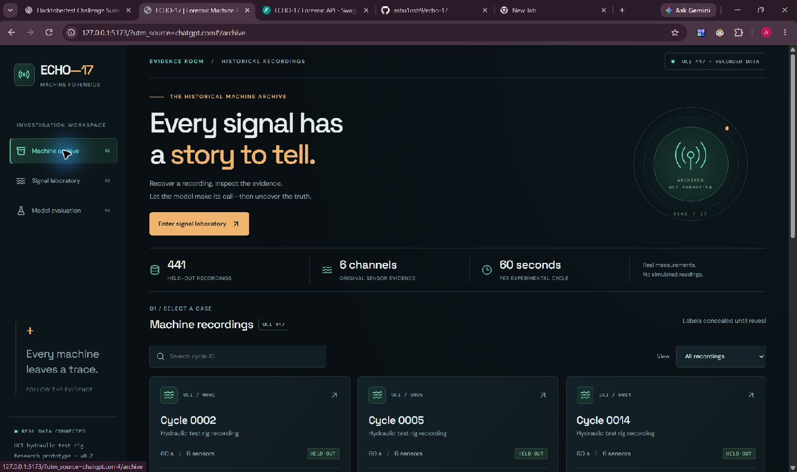

# ECHO-17 - The Machine That Remembers

A forensic lab for real hydraulic-machine recordings: replay measured signals, compare a TRAIN reference, inspect a saved Random Forest prediction, request a genuine Gemma evidence report, then deliberately reveal the recorded condition.

**Release candidate: RF + Gemma. Not pushed, deployed or submitted.** TabPFN remains an offline reproducible research experiment. Its weights, predictions, scores, probabilities and TabPFN-grounded reports are excluded from the hosted payload until permission is confirmed. Full local research evidence is preserved in ignored artifacts and a checksum-recorded private document snapshot.

- [Exact publication manifest and release gate](docs/PUBLICATION_MANIFEST.md)
- [Render Blueprint and approval handoff](docs/RELEASE_HANDOFF.md)
- [Current English article](docs/DEV_SUBMISSION.md)
- [Real media inventory](docs/RELEASE_MEDIA.md) and [60-90 second storyboard](docs/DEMO_SCRIPT.md)
- [Verified checks](docs/RUN_LOG.md), [RF results](docs/MODEL_RESULTS.md), [credits/licenses](THIRD_PARTY_NOTICES.md)

**Hard internal deadline: 31 October 2026, 20:00 IST; code freeze 15:00 IST.** The owner must revoke/rotate the previously exposed Prior Labs key. No credential is required by the public app.



This historical RF screenshot is genuine. Current Gemma/report and hosted/mobile captures remain pending because browser automation is unavailable. No generated screenshot is used.

## What is actually measured?

UCI 447 contains 2,205 aligned 60-second experimental cycles. This implementation uses PS1, FS1, TS1, TS2, VS1 and EPS1, extracting six statistics per channel into 36 predictors. Cycle IDs, all condition labels and stability are excluded from X. Preview charts select original measured samples using supplied timestamps; they do not synthesize a waveform.

The saved stratified split is 1,764 TRAIN / 441 TEST, seed 42. Random Forest: 250 trees, balanced subsample class weights. Actual held-out accuracy **0.9931972789115646**, macro-F1 **0.9932124418669938**, **438 correct / 3 incorrect**. All mistakes (cycles 2, 735, 1467) remain inspectable. Probabilities are uncalibrated, not failure risks.

Cycle 735: RF predicts near failure (3%) at 50.4% model probability; Reveal displays recorded reduced efficiency (20%). Cycle 5 is a correct baseline case. These are cooler-condition classifications on a historical test rig, not future failure times or maintenance recommendations.

## Architecture and public-mode boundary

UCI measurements -> sensor statistics and real previews -> saved RF predictions -> FastAPI -> React/TypeScript/Recharts replay, Ghost, diagnosis, Reveal and evaluation.

Ghost Signature selects an actual full-cooler-efficiency TRAIN recording with train-only standardization. Held-out labels never choose the reference. Other reference components may differ; waveform differences do not establish physical causes.

Local Gemma 3 1B through Ollama selects supplied evidence IDs and an uncertainty framing. Pydantic validates the plan; the backend renders every numerical statement from source evidence. Recorded target labels never enter prompts. Invalid/unavailable generation uses an explicit non-LLM fallback.

Public configuration sets `ECHO_PUBLIC_MODEL_POLICY=rf_only` and `ECHO_REPORT_MODE=precomputed`. It serves all 441 RF diagnoses and four genuine RF-grounded Gemma reports (cycles 5, 735, 2, 1467), clearly labeled precomputed. Other cycles receive an honest deterministic fallback. No live LLM/GPU inference occurs on the public server. TabPFN endpoints/selector/results are suppressed even if restricted files are accidentally copied.

## Reuse this prepared workspace

Do not download, regenerate features or retrain RF unnecessarily. From `backend`:

```powershell
& ./.venv/mission1/Scripts/python.exe -m uvicorn app.main:app --host 127.0.0.1 --port 8000
```

From `frontend`:

```powershell
npm ci --include=dev
npm run build
npm run dev
```

Local research UI: `http://127.0.0.1:5173`. API: `http://127.0.0.1:8000/docs`. Hash routes: `#/archive`, `#/investigation/735`, `#/evaluation`. Local live Gemma setup is in [GEMMA_INVESTIGATOR.md](docs/GEMMA_INVESTIGATOR.md). This machine's verified Python environment is `backend/.venv/mission1`; its older outer venv is broken.

RF-only public-mode preview is on `http://127.0.0.1:8001` after installing the separate RF bundle. These are localhost URLs, not a public deployment. See the handoff for exact commands, checksum and restart settings.

## Fresh experiment and offline research

For a fresh checkout, use Python 3.11/3.12, create a venv, install `backend/requirements.txt`, then run `python -m ml.download_data`, `python -m ml.prepare`, and `python -m ml.train_baseline` from `backend`. These commands are for missing initial artifacts, not for replacing this workspace's preserved experiment.

TabPFN uses the same saved TRAIN/TEST IDs. Its Colab workflow and provenance validation remain in source; see [TABPFN_HANDOFF.md](docs/TABPFN_HANDOFF.md). Actual results are retained locally. This release does not distribute or display them. Publication of those results requires review of the accepted participant terms; precomputation is not a license exemption.

## Verification

With the real data and local API running:

```powershell
# backend
& ./.venv/mission1/Scripts/python.exe -m pytest -q
# frontend
npm.cmd test
npm.cmd run build
npm.cmd run check:preview
```

Tests use genuine local artifacts; only chart layout is stubbed. Public-mode HTTP checks use `ml.verify_api --rf-only`. Exact current results, warnings and commands are in the run log. Render configuration is prepared only; no external URL or DEV entry is claimed.

## Attribution and limits

Helwig, Pignanelli and Schuetze (2015), [UCI 447 / DOI 10.24432/C5CW21](https://doi.org/10.24432/C5CW21), [CC BY 4.0](https://creativecommons.org/licenses/by/4.0/). Changes: six-channel summaries and measured downsampled previews. ECHO-17 source is MIT; dataset, model, output, font and dependency terms remain separate. No restricted checkpoint or weight is redistributed. [Full notices](THIRD_PARTY_NOTICES.md).

The random cycle split includes correlated experiments from one rig. It does not establish unseen-machine generalization, remaining useful life, calibrated failure probabilities or industrial safety. Fresh desktop/mobile visual QA, real video, signed-in challenge access, owner publication approval and actual deployed URL checks remain release gates. Any post-deadline commits must be identified here as required by the contest rules.
