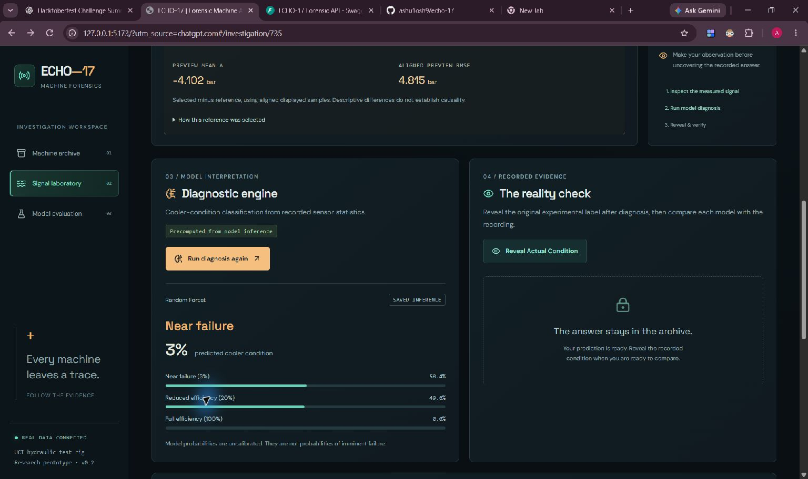

<!-- Final owner review: this is a local draft, not a published entry. Upload genuine media and add only verified video/deployment URLs. The current public challenge page says Live Ended; signed-in submission access remains unverified. Code push, deployment and publication require authorization. -->

*Built for the [Hacktoberfest Open-Source AI Challenge, Week 4: Ghost in the Machine](https://dev.to/challenges/hacktoberfest-week4-2026-10-26).*

## What I Built

Cycle 735 has sixty seconds to tell its story.

Pressure rises, settles, drops and rises again. Flow and temperature leave their own traces. They are real measurements from a hydraulic test rig, waiting in a public research archive.

ECHO-17 opens that recording as a case file. You replay the signals, overlay a measured training reference, ask the classifier for its answer, and finally click **Reveal Actual Condition**.

The Random Forest predicts near failure. Reveal opens the recorded experimental condition: reduced efficiency. The model was wrong, and the application keeps the mistake visible.

That moment is the project's center: a forensic interface where the visitor can investigate an answer instead of accepting a confident card. The title carries a ghost story; the actual task is **classification of historically recorded cooler conditions**. It does not predict when an industrial machine will break.

## Demo

The complete **RF + Gemma release candidate works locally**. Public hosting and a video have not yet been published, so there is no invented demo link here.

These are genuine screenshots from the earlier RF workflow:

**Capture still required:** a current RF-grounded Gemma report, its explicit precomputed label, the final desktop/mobile review and the 60-90 second recording in `docs/DEMO_SCRIPT.md`. These notes are media tasks, not claims of completed capture.

The prepared hosted experience reads actual RF results **precomputed from model inference**. Its four Gemma reports are also genuinely generated and prevalidated, clearly labeled **Precomputed Gemma**. It does not run live GPU or LLM inference. The separate documented local workflow genuinely calls Gemma through Ollama.

## Code

[ECHO-17 on GitHub](https://github.com/ashu1osh9/echo-17)

GitHub's API reports that this public, non-fork repository was created on **29 October 2026 at 18:11:53 UTC**, within the challenge window. Current release changes await owner-authorized publication.

## How I Built It

The evidence comes from [UCI 447: Condition Monitoring of Hydraulic Systems](https://doi.org/10.24432/C5CW21), credited to Helwig, Pignanelli and Schuetze (2015), under CC BY 4.0. Its 2,205 experimental cycles are aligned by row across the sensor recordings and `profile.txt`.

I kept the experiment small enough to inspect. The implementation uses pressure, flow, two temperatures, vibration and motor power. Mean, standard deviation, minimum, maximum and two percentiles for each channel produce **36 sensor-summary predictors**. IDs, all condition labels and stability are excluded from X. Replay selects measured samples at their actual timestamps rather than generating a waveform.

The saved split uses **1,764 TRAIN and 441 TEST cycles**, stratified with seed 42. The Random Forest has 250 trees and balanced subsample class weights. Its results are saved with split IDs, versions, class counts, probabilities and every incorrect case.

| Held-out RF result | Actual value |
|---|---:|
| Accuracy | 0.9931972789115646 |
| Macro-F1 | 0.9932124418669938 |
| Correct / incorrect | 438 / 3 |

The three RF mistakes are cycles **2, 735 and 1467**. Cycle 735 receives a near-failure prediction with model probability **0.504**; the recorded class revealed afterward is reduced efficiency. Cycle 5 provides a correct comparison: predicted and recorded near failure, with model probability **0.628**. These are uncalibrated model outputs, not probabilities of future failure.

### A ghost that is also a measurement

Ghost Signature selects an actual full-cooler-efficiency recording from **TRAIN only**, using train-only standardization. It never uses the held-out label to choose the reference.

Cycle 735 is compared with training recording 1850. For TS1, the aligned-preview mean difference is **+17.6889 degrees Celsius**, with RMSE **17.6902 degrees Celsius**. The report describes those differences without turning them into a physical explanation. A full cooler in the reference does not mean its other components were healthy.

### Gemma chooses evidence, and the backend checks it

Gemma 3 runs locally through Ollama. Genuine RF-grounded cycle 735 and cycle 5 runs were verified using `gemma3:1b`, Q4_K_M, on CPU. The backend supplies measured statistics, the selected RF prediction and real training-reference comparisons. The recorded target label never enters the prompt.

Gemma returns a schema-constrained plan: evidence identifiers and an uncertainty framing. Pydantic rejects unsupported fields, duplicate or unknown references, invalid JSON and incomplete output. The backend renders every numerical statement from source evidence. The report separates context, measurement, reference comparison, model prediction, hypothesis and limitations.

This is bounded evidence planning. The UI says so. If a valid model result is unavailable, it shows an explicitly labeled **Rule-based / non-LLM fallback**, rather than attributing that text to Gemma.

For the small hosted preview, four genuine RF-grounded Gemma reports cover cycles 5, 735, 2 and 1467. Each is revalidated before serving. Other archive cycles remain usable and receive an honest fallback when no saved report exists.

### The comparison stays reproducible without bypassing the license

A genuine TabPFN experiment was also run locally on the exact same split. The full paired comparison and provenance are preserved privately. Because the published model terms restrict outputs as well as weights, those results are **not distributed or served in this public candidate** while permission is unconfirmed.

The open-source experiment/validation workflow remains in the repository. This creates a clear boundary: the public experience demonstrates RF and Gemma; the optional foundation-model study is offline research. No RF result is relabeled as another model, and no absent comparison is filled with invented scores.

### Architecture and reproducibility

React, TypeScript, Vite and Recharts retain the dark forensic interface. FastAPI supplies real archive IDs, measured signals, Ghost, saved RF predictions, Reveal and evaluation. The prepared Render Blueprint serves built static assets and the API from one origin, with a checked RF-only data bundle and no model weights.

The repository documents fresh data preparation, RF reproduction and the separate authorized research workflow. Existing artifacts should be reused rather than retrained. Exact split IDs and hashes support comparison across runs; the public bundle validator rejects unexpected files and any restricted model payload.

## Why Does Open Innovation Matter?

Openness makes the experiment inspectable. The statistics, feature allowlist, split, recorded labels, probabilities and baseline mistakes can be checked independently of the interface. Another builder can change the classifier and evaluate it on the same cycles.

Local Gemma gives the investigator a practical data boundary: after downloading the runtime and model, evidence stays on the local machine for inference. The public preview can replay genuine validated reports without pretending to host the same hardware.

Licensing is part of that transparency. ECHO-17 source is MIT licensed; UCI data is CC BY 4.0. Gemma and TabPFN have separate terms. Model availability is not permission to relicense weights or outputs as MIT.

## Limits That Belong in the Case File

These are correlated cycles from one experimental rig. A random split does not establish unseen-machine generalization, calibrated failure risk, remaining useful life or safe maintenance advice. No chronological or blocked holdout was evaluated. Ghost differences do not prove causality, and small-model evidence selection is not expert diagnosis.

The model's uncertainty and its wrong answers therefore remain part of the interface. The visitor can compare a prediction with the original recording and decide what the evidence actually supports.

## Prize Categories

- **Best Use of Gemma:** genuine local Gemma 3 evidence planning, strict validation and transparent live/precomputed/fallback labels.

Render is not claimed until hosting is actually deployed and verified. TabPFN is documented as offline research; publication of its outcomes or a category claim requiring those outcomes awaits the owner's permission review. No submitted entry is claimed.

## Credits and The Spirit of It

Credit to the UCI dataset authors, Google Gemma, Ollama, Prior Labs for the separate research model, and the Python/React ecosystem. The project extends its existing starter and used Codex assistance; it does not claim invention of the underlying models. Full notices are in `THIRD_PARTY_NOTICES.md`.

The ghost in ECHO-17 is a recording that outlived its experiment. Replaying it gives that evidence another chance to be understood. Leaving the mistaken prediction in the case file gives the viewer a reason to look closely.
