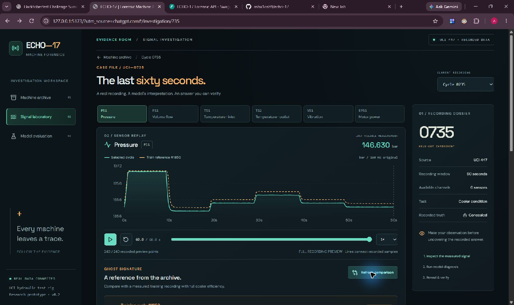
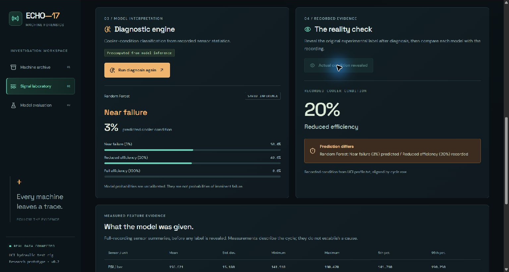
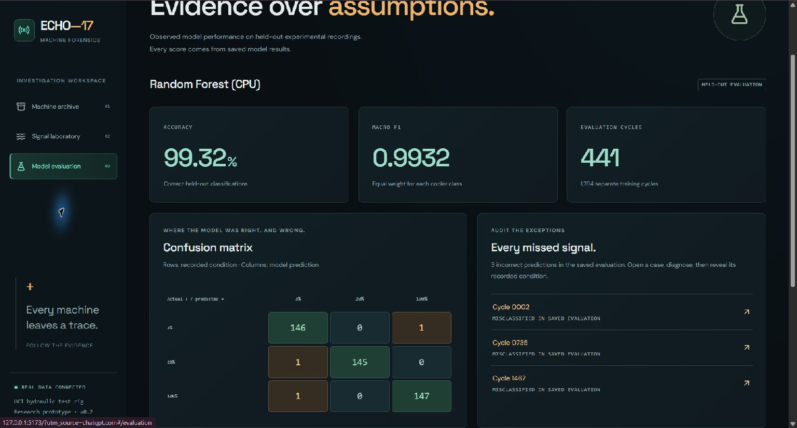

<!-- HISTORICAL DRAFT: superseded by docs/DEV_SUBMISSION.md. LOCAL DRAFT. Before publication: add a real public video/demo URL, upload the screenshots to DEV, verify the repository is public, verify signed-in contest entry access, and remove this editorial note. No submission is claimed. -->

*Prepared for the [Hacktoberfest Open-Source AI Challenge Week 4: Ghost in the Machine](https://dev.to/challenges/hacktoberfest-week4-2026-10-26).*

## What I Built

Cycle 735 lasts sixty seconds. Its pressure trace is an ordinary recording from a hydraulic test rig. ECHO-17 asks you to inspect that recording, let a classifier commit to an answer, and only then uncover the recorded condition.

The classifier gets this one wrong.

That moment is the point of the project. Historical measurements deserve more than a confident label on a dashboard. I wanted a small forensic lab where someone could replay the evidence, inspect a measured reference, and check the model's answer for themselves.

ECHO-17 is a React and FastAPI research prototype for **cooler-condition classification**. The archive contains held-out recordings from UCI's hydraulic-system experiment. You can search a cycle, select one of six sensors, replay its measured samples, request a saved Random Forest prediction, reveal the recorded condition, and inspect the complete held-out evaluation.

The Ghost Signature overlays an actual full-cooler-efficiency **training** recording. Matching uses train-only standardization and never uses the held-out target label to select the reference. Full cooler efficiency does not imply that every other component was healthy; the overlay is a descriptive comparison.

## Demo

**PUBLIC DEMO OR VIDEO LINK REQUIRED BEFORE PUBLICATION.** The application has been verified locally; no hosted URL or recorded video is claimed here yet.

These are screenshots captured from the actual running application. Upload them to DEV and replace these relative paths before publishing:







The demo serves predictions **precomputed from model inference**. Clicking Diagnose retrieves an actual saved result; it does not run a live GPU model. Concealing the label until Reveal is part of the investigation narrative.

## Code

[ECHO-17 repository](https://github.com/ashu1osh9/echo-17)

The repository contains preprocessing, the baseline trainer, saved-split handling, API, frontend, tests and a Colab notebook. Generated data, fitted models, checkpoints and credentials remain outside tracked source.

## How I Built It

The dataset is [Condition Monitoring of Hydraulic Systems, UCI 447](https://doi.org/10.24432/C5CW21), credited to Helwig, Pignanelli and Schütze (2015), under CC BY 4.0. Its `profile.txt` contains 2,205 rows aligned with the same rows across the sensor recordings. Each experiment runs for sixty seconds.

The baseline processes **six** of the dataset's channels: PS1, FS1, TS1, TS2, VS1 and EPS1. For each, it computes mean, standard deviation, minimum, maximum, fifth percentile and ninety-fifth percentile. Those 36 sensor summaries are the predictors. Cycle IDs, cooler labels, all other condition labels and the stability flag are excluded from model X. Replay previews select recorded samples rather than synthesizing waveforms.

The target is cooler efficiency class: **3**, **20** or **100**. A stratified 80/20 split with seed 42 produces 1,764 training cycles and 441 held-out cycles. The Random Forest uses 250 trees with balanced subsample class weights. Exact IDs, versions, class counts, probabilities, errors and the run timestamp are saved alongside its output.

The local RF run produced:

| Metric | Observed value |
|---|---:|
| Accuracy | 0.9931972789115646 |
| Macro-F1 | 0.9932124418669938 |
| Correct / incorrect | 438 / 3 |

The complete confusion matrix uses recorded classes as rows and predicted classes as columns:

| Actual / predicted | 3 | 20 | 100 |
|---|---:|---:|---:|
| 3 | 146 | 0 | 1 |
| 20 | 1 | 145 | 0 |
| 100 | 1 | 0 | 147 |

There are three observed mistakes: cycles 2, 735 and 1467. For cycle 735, the model selects class 3 with probability 0.504, while class 20 receives 0.496. Reveal shows that the recorded class was 20. Cycle 5 provides a correct comparison: predicted and recorded class 3, with model probability 0.628. These are uncalibrated model probabilities.

This is an optimistic within-rig test. Randomly split neighboring experiments can be correlated. I have not evaluated unseen machines, a chronological holdout, remaining useful life or imminent failure. The interface makes no production maintenance recommendation.

**Model integration status:** Random Forest inference is verified. TabPFN-3.5 has not yet run. Its Colab handoff carries the same measured features and saved IDs, explicitly selects V3_5, and checks input hashes and recomputed scores when importing returned results. The [TabPFN checkpoint has separate non-commercial terms](https://huggingface.co/Prior-Labs/tabpfn_3_5). The optional investigator returned a labeled, deterministic **non-LLM fallback** during verification; this is not evidence of a Gemma run. No TabPFN, Gemma or Render partner integration is claimed in this draft.

To reproduce the CPU experiment, install `backend/requirements.txt`, then run from `backend`:

```bash
python -m ml.download_data
python -m ml.prepare
python -m ml.train_baseline
python -m pytest -q
python -m uvicorn app.main:app --reload
```

In a second terminal, run `npm install`, `npm run build` and `npm run dev` from `frontend`. The README documents the verified Windows environment and exact Colab transfer commands. Data download needs internet; once the artifacts exist, local replay and RF-result review do not require an inference API.

## Why Does Open Innovation Matter?

The open-source Random Forest implementation is already doing the classification. Its inputs, split and output can be inspected independently of the interface. Someone can reproduce the feature table, substitute another estimator, and compare both models on exactly the same recordings.

That openness changes what an answer means. A confident card is only one view of an auditable experiment. The incorrect predictions remain in the archive, with their probabilities and recorded conditions available for review. Project code is MIT licensed; that does not relicense the dataset or optional model checkpoints.

## The Spirit of It

The ghost here is a recording that outlived the experiment. Replaying it gives an old test-rig cycle a small second life. Letting the model be wrong—and leaving that mistake visible—is how I keep the story attached to the evidence.

<!-- Publication handoff: follow the current official submission template, verify devchallenge/hf26challenge tags, and keep published: false until ready. Recheck actual partner results before changing category claims. Human author reviews this AI-assisted draft. A published post is not a verified contest entry until the challenge flow confirms it. -->
